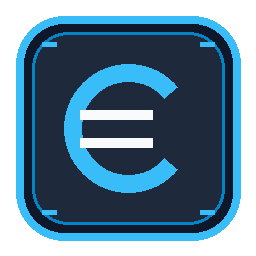

<div align="center">
  
  <h1>Personal Expense Tracker</h1>
  <p><strong>A minimalist, privacy-first, zero-bloat personal finance & scenario forecasting desktop app for Windows.</strong></p>
  <p><em>100% Local • Zero Cloud • ~25 MB RAM • &lt; 10 MB Disk • Euro (€) First</em></p>
</div>

---

## 🌟 Key Features

- **🛡️ 100% Local & Privacy-Protected:**
  - All personal records are stored in a local SQLite file (`data/expenses.db`).
  - The repository's `.gitignore` automatically excludes `data/` and `*.db`, ensuring your personal financial entries are never pushed or leaked to GitHub.
- **⚡ Ultra-Lightweight & Zero Bloat:**
  - Zero Node.js / npm dependencies.
  - Zero heavy Python frameworks (runs using Python's standard library and built-in SQLite).
  - Uses ~25 MB RAM and less than 10 MB of disk space.
- **💶 Euro (€) Focused:**
  - Formatted in Euros across KPI metrics, category breakdowns, transactions, and trajectory forecasts.
- **📈 Runway & Exact Salary Scenario Simulator:**
  - Live runway calculation (how many months until zero or goal reached).
  - Test exact monthly salary amounts (e.g. *"What if my salary is €3,500 vs €4,200?"*).
  - Adjust fixed recurring expenses and discretionary spending.
  - Real-time pure Canvas 12-month projection graphs comparing your baseline against simulations.
- **🖥️ Standalone Desktop App Experience:**
  - Launches in a dedicated borderless Windows app window (no URL bar or browser clutter).
  - Custom geometric vault desktop shortcut icon.
- **📥 Data Portability:**
  - Instant 1-click **Export CSV** for Excel or offline backups.

---

## 🚀 Quick Start

### 1. Requirements
- Windows 10 / 11
- Python 3.8+ (standard installation)

### 2. Launching the App
1. **Double-click:** Run `create_desktop_shortcut.bat` once to place the **Personal Expense Tracker** icon on your Desktop.
2. From then on, simply double-click the **Personal Expense Tracker** shortcut on your Desktop to open the app.
3. *(Alternative)* Run `run_app.bat` directly from this directory.

---

## 📁 Project Structure

```text
├── assets/
│   ├── icon.ico            # Windows multi-size application icon
│   └── icon.png            # High-res branding icon
├── web/
│   ├── index.html          # Clean single-page application layout
│   ├── style.css           # Modern dark-theme stylesheet
│   ├── app.js              # Reactive UI, table filters, Canvas charts
│   ├── manifest.json       # App manifest for standalone window mode
│   └── favicon.ico         # App favicon
├── analytics.py            # Financial runway, goal math & scenario simulation engine
├── database.py             # Local SQLite CRUD & aggregation helpers
├── server.py               # Lightweight standard-library REST API & static server
├── run_app.bat             # Desktop launcher script
├── run_app.vbs             # Silent windowless launcher
├── create_desktop_shortcut.bat  # Creates custom desktop shortcut
├── tests/                  # Full unit test suite (15 tests)
└── README.md
```

---

## 🧪 Running Tests

To run the automated test suite:

```bash
python -m unittest discover tests
```

---

## 🔒 Privacy & Sharing Guarantee

The local database (`data/expenses.db`) is ignored by Git by design. You can safely clone, branch, or share this repository without your real financial transactions ever leaving your computer.

---

## 📄 License
MIT License. Free to use and customize for personal finance management.
